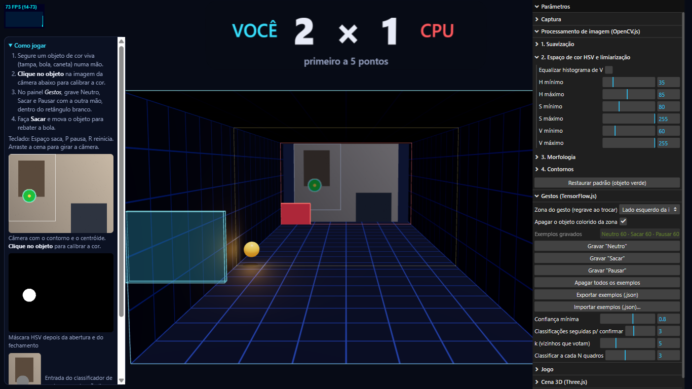
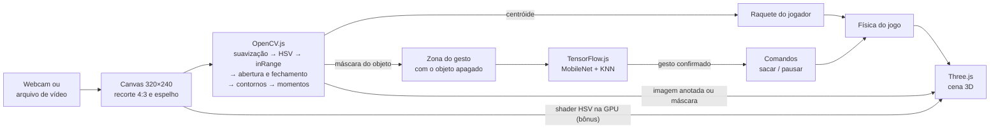
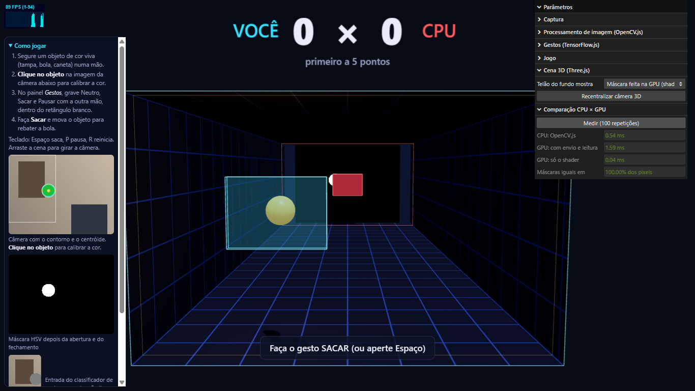
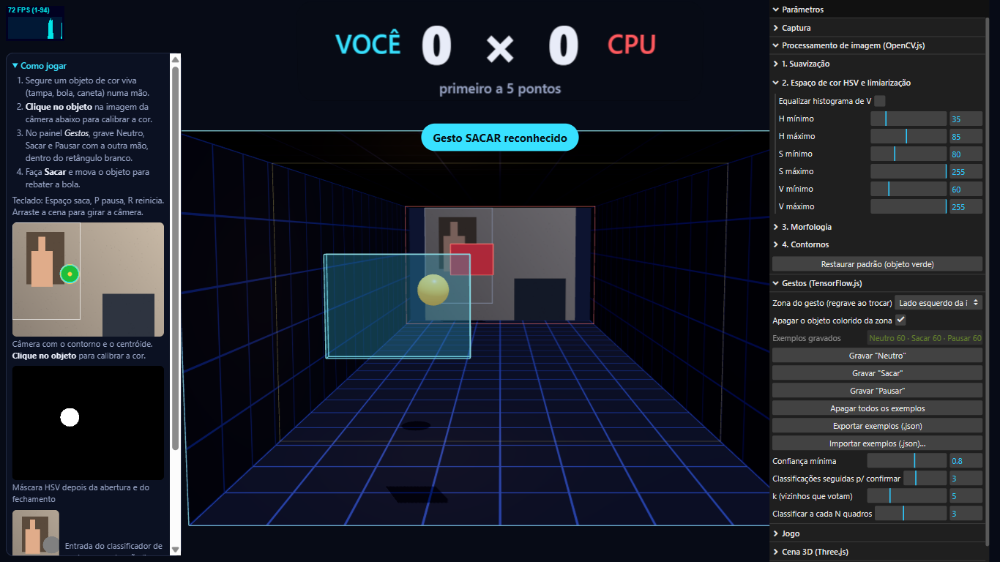

# Rebote 3D

Jogo 3D de rebater a bola dentro de um túnel, controlado pela webcam. O jogador segura um objeto colorido: o **OpenCV.js** encontra esse objeto em cada quadro e a raquete segue o centróide dele. Com a outra mão, o jogador faz gestos que um classificador do **TensorFlow.js**, treinado no próprio navegador, reconhece para sacar e pausar. O **Three.js** desenha o túnel, a bola, as raquetes, o placar e um telão com o que a visão computacional está enxergando.

Atividade de laboratório das disciplinas de Processamento Digital de Imagens (PDI) e Computação Gráfica (CG).

| | |
|---|---|
| **Tema** | 7. Jogo 3D controlado pela webcam (Pong em túnel 3D) |
| **Integrantes** | Lucas Fernandes · _demais integrantes: a preencher_ |
| **Aplicação publicada** | https://biokrypty.github.io/rebote-3d/ |
| **Vídeo de demonstração** | _a preencher_ |



## Como jogar

1. Segure um objeto de **cor viva** numa mão (tampa de garrafa, bola, caneta marca-texto).
2. **Clique no objeto** na imagem da câmera, no painel da esquerda. A faixa de cor HSV é calibrada a partir do ponto clicado.
3. No painel **Gestos (TensorFlow.js)**, grave os três gestos com a outra mão, dentro do retângulo branco que aparece na imagem da câmera:
   - **Neutro:** mão fora ou parada, jogando normalmente;
   - **Sacar:** por exemplo, punho com o polegar para cima;
   - **Pausar:** por exemplo, mão aberta.

   Cada botão espera 2 s e grava 30 quadros. Mexer um pouco a mão durante a gravação deixa o classificador mais robusto. Os exemplos ficam salvos no navegador.
4. Faça **Sacar** e mova o objeto para rebater a bola. A CPU joga no fundo do túnel; quem fizer 5 pontos vence.

**Teclado (reserva):** Espaço saca ou continua, P pausa, R reinicia. Arrastar a cena gira a câmera 3D. Sem webcam, a raquete passa a seguir o mouse.

## Como executar

Requisitos: Node.js 22.12 ou mais novo (testado com o 24) e um navegador com WebGL (Chrome, Edge ou Firefox atuais).

```bash
npm install
npm run dev       # abre em http://localhost:5173/rebote-3d/
npm test          # 47 testes da lógica do jogo, da visão e da IA
npm run build     # gera a pasta dist/
npm run preview   # serve o build em http://localhost:4173/rebote-3d/
```

O navegador só libera a webcam em `localhost` ou em HTTPS. Para testar em outro aparelho da rede, publique (veja abaixo) ou use `npm run dev -- --host` com HTTPS configurado.

**Publicação:** cada push na `main` roda o workflow [`.github/workflows/pages.yml`](.github/workflows/pages.yml). Ele instala as dependências, roda os testes, gera o build e publica no GitHub Pages. O `base` do `vite.config.js` é `/rebote-3d/`, o nome do repositório.

## Pipeline



A cada quadro novo da câmera ([`src/main.js`](src/main.js)):

1. **Captura** ([`src/capture.js`](src/capture.js)): o vídeo é recortado no centro em 4:3, espelhado (no caso da webcam) e reduzido a 320×240 num canvas. Só é processado quando chega um quadro novo (`requestVideoFrameCallback`).
2. **PDI** ([`src/vision/opencv.js`](src/vision/opencv.js)): o OpenCV.js segmenta o objeto pela cor e calcula o centróide.
3. **Integração PDI → jogo** ([`src/game/controle.js`](src/game/controle.js)): o centróide (0 a 1 na imagem) vira a posição x/y da raquete no túnel, com sensibilidade ajustável e suavização temporal (média móvel exponencial corrigida pelo tempo do quadro).
4. **Integração PDI → IA:** a máscara do objeto, dilatada, pinta de cinza o objeto dentro da zona do gesto. Essa zona recortada é a entrada da rede. Sem isso, a posição do objeto pesaria mais que o gesto na comparação.
5. **IA** ([`src/controleGestos.js`](src/controleGestos.js), [`src/vision/model.js`](src/vision/model.js)): a MobileNet extrai as características da zona e o KNN compara com os exemplos gravados. Um gesto só vira comando depois de várias classificações seguidas acima da confiança mínima.
6. **Jogo** ([`src/game/game.js`](src/game/game.js)): física da bola, colisões, placar e estados (saque, jogando, pausado, fim).
7. **CG** ([`src/scene/`](src/scene/)): o Three.js copia o estado do jogo para a cena e usa a imagem processada como textura dinâmica do telão.

## Técnicas de PDI (OpenCV.js)

Todas as etapas têm parâmetros no painel **Processamento de imagem (OpenCV.js)**, feito com lil-gui.

| Etapa | Categoria | Funções do OpenCV.js | Parâmetros no painel | Para quê |
|---|---|---|---|---|
| 1 | Suavização | `GaussianBlur`, `medianBlur` | filtro (nenhum, gaussiano, mediana) e tamanho do kernel | tirar o ruído do sensor antes de limiarizar |
| 2 | Espaço de cor | `cvtColor` (RGBA→RGB→HSV) | — | separar a cor (H) do brilho (V); a matiz do objeto muda pouco com a luz |
| 3 | Histograma | `split`, `equalizeHist`, `merge` | liga/desliga a equalização do canal V | espalhar os níveis de brilho em ambiente escuro |
| 4 | Limiarização / segmentação | `inRange`, `bitwise_or` | H, S e V mínimos e máximos | máscara binária do objeto; o vermelho usa duas faixas que "dão a volta" no círculo de matiz |
| 5 | Morfologia | `morphologyEx` (abertura e fechamento), `getStructuringElement` | tamanho da abertura e do fechamento | a abertura apaga pontinhos de ruído e o fechamento tapa buracos no objeto |
| 6 | Contornos | `findContours`, `contourArea`, `drawContours` | área mínima | o maior contorno é o objeto; o resto é descartado |
| 7 | Momentos | `moments`, `minEnclosingCircle` | — | centróide = (m10/m00, m01/m00), que vira a posição da raquete |
| 8 | Máscara e ROI para a IA | `dilate`, `Mat.setTo` com máscara, `Mat.roi` | zona do gesto, apagar o objeto | entrada limpa para o classificador de gestos |

A **calibração por clique** lê o HSV de uma janela 5×5 em volta do ponto clicado. A média da matiz é circular, para que 175 e 5 deem vermelho, e não verde. A partir dessa média a faixa da limiarização é montada ([`src/vision/hsv.js`](src/vision/hsv.js)).

## Aprendizado de máquina (TensorFlow.js)

- **Modelo:** transfer learning com MobileNet v1 (largura 0,5, entrada 224×224) como extratora de características. Ela devolve um vetor de 512 números por imagem, e um **classificador KNN** (`@tensorflow-models/knn-classifier`) compara esse vetor com os exemplos gravados.
- **Treino no navegador:** treinar é gravar exemplos de cada gesto (Neutro, Sacar, Pausar). Não há servidor. Os pesos da MobileNet ficam em `public/models/`, então o jogo funciona sem internet.
- **Tempo real:** a classificação roda a cada 3 quadros novos (ajustável), de forma assíncrona e com backend WebGL. A renderização não espera por ela.
- **Do gesto ao comando** ([`src/vision/gestos.js`](src/vision/gestos.js)): exige confiança mínima, várias classificações seguidas e a volta ao Neutro antes de repetir o mesmo comando. Assim, segurar "Sacar" não lança a bola de novo logo depois de cada ponto.
- **Persistência:** os exemplos ficam no `localStorage` e podem ser exportados e importados em `.json`. O arquivo importado é validado antes de virar tensor: gestos conhecidos, tamanho, versão e valores finitos ([`src/vision/persistencia.js`](src/vision/persistencia.js)).

## Computação gráfica (Three.js)

- **Câmera:** perspectiva, atrás da raquete do jogador, com `OrbitControls` (girar, aproximar, deslocar) e um botão para recentralizar.
- **Luzes:**
  - `HemisphereLight`, que ilumina tudo;
  - `DirectionalLight` com sombras, que projeta no chão a sombra da bola e das raquetes e ajuda a perceber a profundidade;
  - `PointLight` presa à bola, que ilumina as paredes por onde ela passa.
- **Geometrias:**
  - `PlaneGeometry`: túnel, telão e placar;
  - `SphereGeometry`: bola;
  - `BoxGeometry` com `EdgesGeometry`: raquetes;
  - `RingGeometry`: mira;
  - `LineLoop`: anel que acompanha a profundidade da bola.
- **Materiais:**
  - `MeshStandardMaterial` e `MeshBasicMaterial`;
  - `MeshPhysicalMaterial`: raquete do jogador transparente, com clearcoat;
  - `LineBasicMaterial`;
  - `ShaderMaterial`: bônus.
- **Texturas:**
  - grade procedural do túnel (`CanvasTexture` com `RepeatWrapping`);
  - **telão dinâmico** com a imagem da câmera anotada pelo OpenCV ou com a máscara, atualizado a cada quadro;
  - placar desenhado num canvas.
- **Animação** em `renderer.setAnimationLoop`:
  - movimento da bola e da raquete da CPU;
  - giro e pulsação da bola;
  - brilho das raquetes ao rebater e do anel ao bater na parede.
- **Física:**
  - reflexão especular nas paredes;
  - colisão bola–raquete, com efeito conforme o ponto de contato e aceleração a cada rebatida;
  - subpassos para a bola não atravessar a raquete em alta velocidade.

## Desempenho e memória

- O processamento roda em 320×240. Num notebook com GPU integrada Intel UHD, com câmera, OpenCV, classificador e cena 3D ligados ao mesmo tempo:
  - média de **~80 FPS**;
  - 95% dos quadros abaixo de 25 ms;
  - OpenCV.js entre 4 e 10 ms por quadro;
  - TensorFlow.js entre 28 e 56 ms por classificação, fora do caminho da renderização.

  O FPS aparece na tela (stats.js, canto superior esquerdo). Os tempos de OpenCV e TensorFlow aparecem no painel da esquerda.
- **OpenCV.js:** todas as `cv.Mat` do pipeline são criadas uma única vez e reaproveitadas a cada quadro. Os contornos temporários recebem `delete()` na hora, e `liberar()` chama `delete()` em todas as matrizes ao sair da página.
- **TensorFlow.js:** cada inferência roda dentro de `tf.tidy()` e a embedding da classificação é liberada com `dispose()`. O painel mostra o número de tensores vivos (`tf.memory()`), que fica estável durante o jogo.
- O OpenCV.js (~15 MB) e o TensorFlow.js são carregados com `import()` dinâmico, em arquivos separados. A cena aparece e responde antes de eles terminarem de baixar.

## Bônus

1. **Shader próprio aplicando um filtro de PDI na GPU** ([`src/scene/gpuFiltro.js`](src/scene/gpuFiltro.js)): um `ShaderMaterial` converte RGB→HSV na mesma convenção do OpenCV (H de 0 a 180) e limiariza com os mesmos parâmetros do painel. Em **Cena 3D → Telão do fundo mostra → Máscara feita na GPU**, o telão exibe o resultado.
2. **Modelo treinado pela equipe no navegador:** o classificador de gestos (KNN sobre as características da MobileNet) é treinado ao vivo, com os gestos de quem joga.
3. **Comparação CPU × GPU:** **Comparação CPU × GPU → Medir** roda 100 vezes a mesma conversão HSV + limiarização no OpenCV.js (CPU, WebAssembly) e no shader (GPU), e confere se as máscaras são iguais. Valores obtidos no notebook de desenvolvimento:

   | Medida | Tempo médio |
   |---|---|
   | CPU: OpenCV.js | 0,5 a 1,2 ms |
   | GPU: envio do quadro + shader + leitura da máscara | 1,6 a 3,0 ms |
   | GPU: só o shader | 0,04 a 0,13 ms |
   | Máscaras iguais | 100% dos pixels |

   **Leitura:** o shader sozinho é cerca de 10 vezes mais rápido, mas enviar o quadro para a GPU e ler a máscara de volta custa mais que o filtro inteiro na CPU nesse tamanho de imagem. Como o `findContours` precisa da máscara na CPU, o pipeline do jogo usa o OpenCV. A GPU compensa quando o resultado fica nela, como no telão.



## Testes

`npm test` roda 47 testes com Vitest:
- física do jogo: reflexão, rebatida, efeito, ponto, vitória, pausa e o caso da bola rápida que não pode atravessar a raquete;
- mapeamento do centróide para a raquete e a suavização independente do FPS;
- faixas HSV, média circular e calibração;
- confirmação de gestos e zona do gesto;
- validação dos arquivos de exemplos;
- comparação das máscaras de CPU e GPU.

O pipeline do OpenCV e o classificador também foram testados no navegador com uma câmera simulada: um canvas animado com uma bola verde e "mãos" desenhadas. O resultado foi 18 de 18 gestos reconhecidos, com a bola em seis posições diferentes, inclusive dentro da zona do gesto.

## Estrutura do projeto

```
rebote-3d/
├── index.html                 painel lateral, mensagens e elementos de vídeo
├── vite.config.js             base do GitHub Pages
├── public/
│   └── models/                pesos da MobileNet v1 0.5 (servidos localmente)
├── docs/capturas/             capturas de tela do README
└── src/
    ├── main.js                inicialização, pipeline de cada quadro e loop
    ├── capture.js             webcam / arquivo de vídeo → canvas 320×240
    ├── controleGestos.js      gravação, classificação e persistência dos gestos
    ├── ui.js                  painel lil-gui e stats.js
    ├── vision/
    │   ├── opencv.js          carregamento do OpenCV e rastreamento por cor
    │   ├── hsv.js             faixas HSV e calibração
    │   ├── model.js           MobileNet + KNN (TensorFlow.js)
    │   ├── gestos.js          gestos, zona e confirmação de comandos
    │   └── persistencia.js    salvar, exportar e validar exemplos
    ├── game/
    │   ├── game.js            física, colisões, placar e estados
    │   └── controle.js        centróide → raquete, suavização temporal
    └── scene/
        ├── scene.js           renderer, câmera, luzes e OrbitControls
        ├── objects.js         túnel, bola, raquetes, telão e placar
        └── gpuFiltro.js       shader HSV e medição CPU × GPU (bônus)
```

## Capturas de tela



As capturas foram feitas com a câmera simulada dos testes automatizados (imagem sintética), não com uma webcam real.

## Limitações conhecidas

- A segmentação por cor depende da iluminação. Com luz muito diferente, é preciso calibrar de novo (clique no objeto) e talvez ligar a equalização.
- O classificador de gestos aprende o ambiente de quem gravou: fundo, luz e roupa. Em outro lugar, o ideal é gravar os gestos de novo.
- Trocar a zona do gesto exige gravar os gestos de novo.
- Pensado para computador com webcam; não foi ajustado para celular.

## Uso de IA generativa e créditos

- **IA generativa:** o código, os testes e este README foram escritos com auxílio do assistente de programação Claude Code (Anthropic), como permitem as regras da atividade.
- **Bibliotecas:**
  - [Three.js](https://threejs.org/) (MIT);
  - [OpenCV.js](https://docs.opencv.org/) via [`@techstark/opencv-js`](https://github.com/TechStark/opencv-js) (Apache-2.0);
  - [TensorFlow.js](https://www.tensorflow.org/js), [`@tensorflow-models/mobilenet`](https://github.com/tensorflow/tfjs-models/tree/master/mobilenet) e [`@tensorflow-models/knn-classifier`](https://github.com/tensorflow/tfjs-models/tree/master/knn-classifier) (Apache-2.0);
  - [lil-gui](https://lil-gui.georgealways.com/) (MIT);
  - [stats.js](https://github.com/mrdoob/stats.js) (MIT);
  - [Vite](https://vite.dev/) e [Vitest](https://vitest.dev/) (MIT).
- **Modelo:** MobileNet v1 0.5 224, pré-treinada no ImageNet pelo Google e publicada no TensorFlow Hub (Apache-2.0).

## Referências

- [Documentação do Vite](https://vite.dev/guide/)
- [Documentação do Three.js](https://threejs.org/docs/) e [exemplos oficiais](https://threejs.org/examples/)
- [Tutoriais do OpenCV.js](https://docs.opencv.org/4.x/d5/d10/tutorial_js_root.html)
- [Modelos pré-treinados do TensorFlow.js](https://www.tensorflow.org/js/models)
- [Repositório tfjs-models](https://github.com/tensorflow/tfjs-models)
